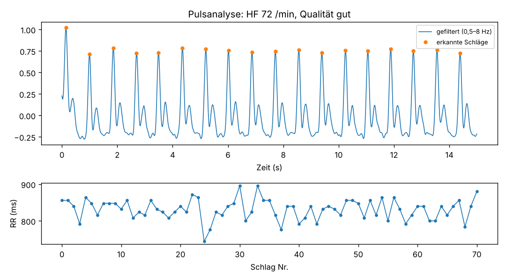

# biosignal-gdt


Pulsanalyse mit GDT-Anbindung an die Praxissoftware: ein kleines Demo-Projekt, das zeigt, wie ein medizinisches Messgerät über die **GDT-Schnittstelle** (Gerätedatenträger, Version 2.1) mit einer Praxisverwaltungssoftware zusammenarbeitet.

> Demo- und Lernprojekt. **Kein Medizinprodukt**, nicht für Diagnosen. Alle Patientendaten in `samples/` sind erfunden.

## Worum es geht

In Arztpraxen sind EKG-, Spirometrie- oder Blutdruckgeräte meist per GDT an die Praxissoftware angebunden. Der Ablauf:

```
Praxissoftware                      Gerät / Auswertung (dieses Projekt)
--------------                      -----------------------------------
Satzart 6302  "Neue Untersuchung anfordern"  ──►  liest Patient + Auftrag
                                                  wertet Pulssignal aus (PPG/EKG)
Satzart 6310  "Daten einer Untersuchung"     ◄──  schreibt Messwerte + Befundtext
```

Das Projekt

1. **liest und prüft GDT-Dateien** (Zeilenlängen, Satzlänge 8100, Pflichtfelder, Datumsformat, Zeichensatz 9206),
2. **wertet ein Pulssignal aus**: Bandpassfilter, Schlagerkennung mit Gegenprobe über die Autokorrelation, Herzfrequenz, HRV (SDNN, RMSSD) und eine **Plausibilitätsprüfung der Signalqualität**,
3. **schreibt den Ergebnis-Datensatz 6310** mit Patientendaten aus der Anforderung, Messwerten (8410/8411/8420/8421) und Befundtext (6220),
4. **prüft das eigene Ergebnis** vor der Rückgabe erneut und erstellt ein Diagramm.



## Schnellstart

```bash
python3 -m venv .venv && source .venv/bin/activate
pip install -r requirements.txt

# GDT-Datei anzeigen und prüfen
python -m biosignal_gdt pruefen samples/anforderung_6302.gdt

# Anforderung beantworten, mit künstlichem Testsignal
python -m biosignal_gdt messen samples/anforderung_6302.gdt --synthetisch --aus ausgabe

# ... oder mit echtem Signal, z. B. PPG aus dem BIDMC-Datensatz (PhysioNet), 125 Hz
python -m biosignal_gdt messen samples/anforderung_6302.gdt --csv bidmc_01_Signals.csv --spalte PLETH --fs 125

# Tests
python -m unittest discover -s tests -t .
```

## Aufbau

| Datei | Inhalt |
|---|---|
| `biosignal_gdt/gdt.py` | GDT lesen, schreiben, validieren; Satzlänge wird automatisch berechnet |
| `biosignal_gdt/signal.py` | Filter, Schlagerkennung, HF/HRV, Signalqualität, Testsignal |
| `biosignal_gdt/workflow.py` | Ablauf 6302 → Auswertung → 6310, Befundtext, Diagramm |
| `biosignal_gdt/cli.py` | Kommandozeile `pruefen` und `messen` |
| `tests/` | 16 Tests, u. a. Satzlänge, Umlaute (1 Byte in ANSI), fehlerhafte Zeilen, HF-Genauigkeit von 35 bis 150 /min |

## Designentscheidungen

- **Validierung vor und nach der Verarbeitung.** Eine fehlerhafte Anforderung wird abgelehnt, und die eigene Antwort wird vor der Rückgabe erneut geprüft. In der Praxis sind fehlerhafte Schnittstellendateien eine häufige Ursache für Supportfälle.
- **Einfache, nachvollziehbare Signalverarbeitung** statt Black Box. Bei schlechter Signalqualität wird das im Befundtext gesagt, statt einen unsicheren Wert stillschweigend zu übernehmen. Diese Erfahrung stammt aus meiner Arbeit an einem Multispektral-Photometer: Robuste, tolerante Verfahren sind im Alltag oft wertvoller als scheinbar exakte.
- **Zeichensatz bewusst behandelt** (Feld 9206: 2 = CP437, Standard ohne Angabe; 3 = ANSI/Windows-1252): Umlaute in Namen ändern die Zeilenlänge in Bytes.
- **Gegenprobe bei der Schlagerkennung.** Ein Test bei niedriger Herzfrequenz (40 /min) zeigte, dass die Nebenwelle der Pulskurve (dikrote Welle) als zusätzlicher Schlag gezählt wurde. Seitdem schätzt das Programm den Schlagabstand zusätzlich über die Autokorrelation, passt den Mindestabstand daran an und stuft die Qualität herab, wenn beide Verfahren nicht zusammenpassen. Der Fall ist als Testfall abgesichert.

## Grenzen

- Nur die Felder, die für diesen Ablauf nötig sind, keine vollständige Umsetzung der GDT-Spezifikation.
- Die Verfahrenskennung `PULS01` (Feld 8402) ist frei gewählt; in echten Systemen wird sie pro Gerät konfiguriert.
- Keine Dateiüberwachung (Austauschordner), keine Anbindung an eine echte Praxissoftware; der Dateiname folgt nicht der üblichen GDT-Benennung aus Empfänger- und Senderkürzel.
- Zeichensatz 1 (DIN 66003) wird vereinfacht als ASCII gelesen.
- Die Schlagerkennung ist auf synthetischen Signalen getestet; echte Signale mit Bewegungsartefakten brauchen weitere Tests.

## Wie das Projekt entstanden ist

Entwickelt mit **Claude Code** (agentische KI-Programmierung). Die Ergebnisse habe ich geprüft und den Code durchgearbeitet. Die GDT-Grundlagen habe ich anhand öffentlicher Beschreibungen von Geräteherstellern geprüft.

Nächste Schritte, die ich mir vorgenommen habe: Austauschordner überwachen, Satzart 6311 (Daten zeigen), Ausgabe zusätzlich als HL7-FHIR-`Observation`.

---
Aron Dunai-Kovács · B.Eng. Medizintechnik (EAH Jena)
